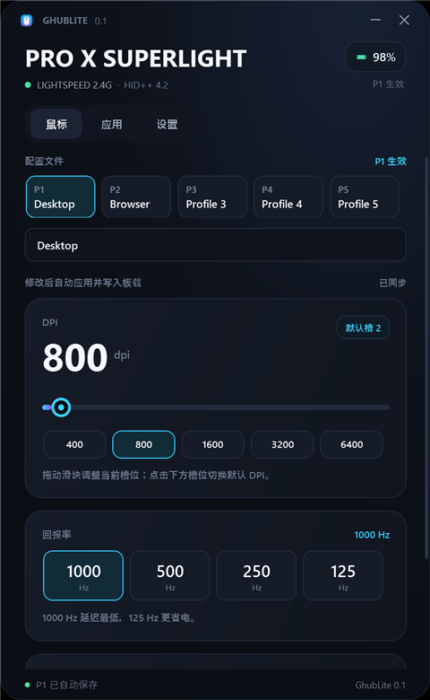
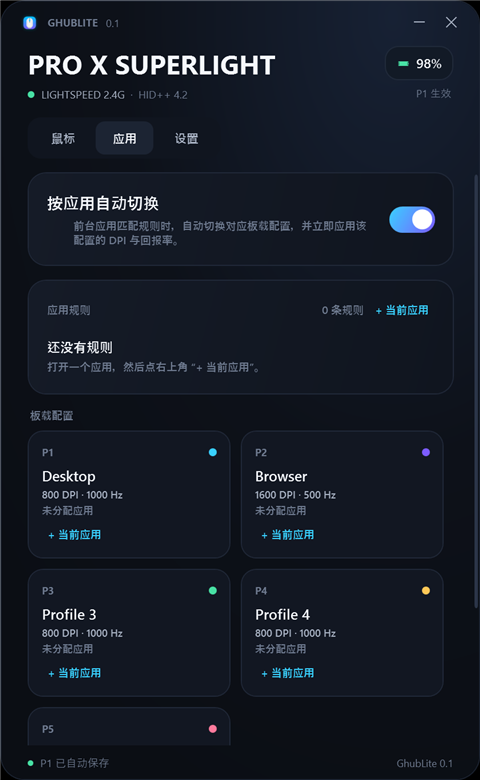
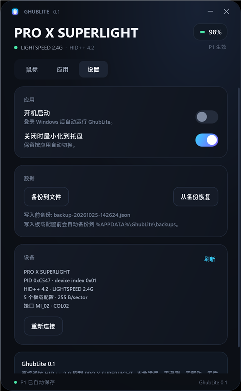

# GhubLite

一个直接通过 **Logitech HID++ 2.0** 控制 **GPW2（G PRO X SUPERLIGHT）** 的轻量 Windows 托盘工具。

不安装 G HUB、不装内核驱动、不跑后台服务、不用 Electron。单个 GUI 进程，关闭窗口后缩到托盘。



## 功能

- **DPI**：100–25600，步进 50；5 个板载 DPI 槽位，点击槽位或拖动滑块立即生效
- **回报率**：1000 / 500 / 250 / 125 Hz，点击数字立即生效
- **电量**：百分比、充电状态、低电量托盘提醒
- **自动保存**：参数改动后约 1 秒自动写入板载 Profile；不需要点“保存”
- **硬件同步校验**：每次修改会切换到 HOST 模式，发送 DPI/回报率，再回读硬件状态与 Profile；一致时弹出「修改成功」，不一致会提示失败
- **板载持久化**：DPI、默认槽、回报率、配置名称写入鼠标 Profile；重新插拔/重启后仍保留
- **5 个板载 Profile**：P1–P5，可分别配置 DPI 与回报率
- **按应用自动切换**：前台应用命中规则时，自动切换对应 Profile 并立即应用其 DPI/回报率；未命中时回到默认 P1
- **备份 / 恢复**：首次写入前自动把 5 个 Profile + 控制区备份为 JSON
- **托盘**：单击/双击打开；右键切换 Profile、开关自动切换、退出
- **快捷键**：`Ctrl+S` 立即保存（一般不需要，自动保存已覆盖），`F5` 刷新设备状态





## 运行要求

- Windows 10 / 11 x64
- **.NET 10 Desktop Runtime**（本机已安装；如果分发到其他机器，请安装，或使用 self-contained 发布）
- 鼠标通过 LIGHTSPEED 接收器（`046d:c547`）或 USB 线（`046d:c094`）连接
- 建议不要同时运行 Logitech G HUB / Onboard Memory Manager，避免同时占用 HID++ 设备

## 快速开始

1. 运行 `dist\GhubLite\GhubLite.exe`
2. 首次启动会读取鼠标的 5 个板载 Profile
3. 在「鼠标」页选择配置，拖动 DPI 滑块或点击 DPI/回报率数字：鼠标立即生效，约 1 秒后自动写入板载，并弹出「修改成功」
   - 程序运行时会切到 **HOST 模式**，这样 `0x2201/0x8060` 才真正控制传感器；退出时恢复 ONBOARD 模式
   - 如果设备休眠/未连接，按 `F5` 刷新或重新打开程序
4. 在「应用」页：
   - 打开目标应用，切到它，然后点右上角「+ 当前应用」，规则会加到当前选中的 Profile
   - 也可以点某个 Profile 卡片上的「+ 当前应用」直接指定
   - 前台应用命中规则时自动切换；关闭「按应用自动切换」可停用
5. 关闭窗口 = 最小化到托盘；右键托盘图标 → 退出

> 首次写入前会自动备份到 `%APPDATA%\GhubLite\backups\`。电量较低时建议先充电再写板载配置。

## 数据位置

| 内容 | 路径 |
|---|---|
| 配置（规则、开机启动、托盘行为） | `%APPDATA%\GhubLite\config.json` |
| 自动备份 | `%APPDATA%\GhubLite\backups\backup-*.json` |
| 错误日志 | `%APPDATA%\GhubLite\logs\error.log` |

## 命令行工具

`dist\GhubLite\tools\GhubLite.Cli.exe` 可用于诊断和脚本化：

```text
info                         设备、电量、DPI、回报率、当前 Profile
battery                      电量
dpi [value]                  读/写实时 DPI
rate [1000|500|250|125]      读/写实时回报率
profiles                     列出 5 个板载 Profile
profile <1-5>                查看 Profile 原始数据
profile-set <n> <dpi1..dpi5> <default> <rateMs> <name>
                             写入板载 Profile（自动备份）
switch <1-5>                 切换 Profile 并应用其 DPI/回报率
mode [host|onboard]          查看/切换板载模式（host 才实时生效）
enable-profiles              启用全部 5 个板载 Profile（自动备份）
backup                       备份到 %APPDATA%\GhubLite\backups
restore <backup.json>        从备份恢复（恢复前自动再备份）
```

示例：

```powershell
GhubLite.Cli.exe info
GhubLite.Cli.exe profile-set 2 400,800,1600,3200,6400 2 2 Browser
GhubLite.Cli.exe switch 2
```

## 构建

```powershell
dotnet build GhubLite.slnx -c Release
dotnet run --project src/GhubLite.App
```

发布为轻量文件夹（约 1.6 MB，含文档截图；依赖本机 .NET 10 Desktop Runtime）：

```powershell
dotnet publish src/GhubLite.App/GhubLite.App.csproj -c Release -o dist/GhubLite
dotnet publish src/GhubLite.Cli/GhubLite.Cli.csproj -c Release -o dist/GhubLite/tools
```

运行 `dist\GhubLite\GhubLite.exe`。如果目标机器没有 .NET 运行时，可以使用
`dotnet publish ... -r win-x64 --self-contained true`，体积会明显变大。

## 结构

```text
src/
  GhubLite.Core/   HID 传输、HID++ 2.0 报文、0x8100 Profile、CRC、备份、前台应用监听
  GhubLite.App/    WPF 托盘界面
  GhubLite.Cli/    诊断/自动化 CLI
docs/              界面截图
```

## 协议要点

- 长报文：`11 dev feat (func<<4|swId) payload[16]`，20 字节
- 接收器后 `dev = 1`；USB 直连 `dev = 0xFF`
- 控制集合：`MI_02` 的 Usage Page `FF00` / Usage `0002`
- 每次启动通过 `0x0000/0x00 getFeature` 动态发现 feature index
- DPI：`0x2201`；回报率：`0x8060`；电量：`0x1004`
- 板载配置：`0x8100`，Profile 1–5 各 255 字节，sector 0 为控制区
- CRC：CRC-16/CCITT-FALSE，poly `0x1021`，init `0xFFFF`，大端放在末尾两字节
- 写序列：`fn6` 开始 → 每 16 字节 `fn7` → `fn8` 提交 → 回读校验
- 切 Profile 后固件不一定自动重载 DPI，所以应用会显式再写一次 `0x2201` 和 `0x8060`

参考：Solaar 的 HID++ 特性表与 0x8100 实现、OpenLogi 的协议文档。项目为 clean-room 实现；Solaar 为 GPL，未复制其代码。

## 限制

- 仅针对 **GPW2 / G PRO X SUPERLIGHT（WPID 4093）** 做设备识别与 UI；Superlight 2 或其他鼠标的特性集不同，需要另加能力映射
- 这只鼠标没有 RGB；不支持灯效
- 本工具不做按键重映射、宏、RGB、固件升级、重新配对
- 按应用切换使用 5 个板载 Profile；规则数量不限，多条规则可以指向同一个 Profile
- 若 G HUB 正在运行，可能抢占 HID++ 设备，请退出 G HUB 后再使用
- 程序为了实时控制会临时切到 HOST 模式；正常退出会恢复 ONBOARD 模式。若直接杀进程，鼠标可能留在 HOST 模式，重新打开程序或执行 `GhubLite.Cli.exe mode onboard` 即可恢复
- 只有 HOST 模式下 `0x2201/0x8060` 才会真正驱动传感器；ONBOARD 模式下固件可能回读新值但实际仍按板载 Profile 运行

## License

MIT。与 Logitech 无关联；Logitech、G PRO、LIGHTSPEED 是其各自权利人的商标。
